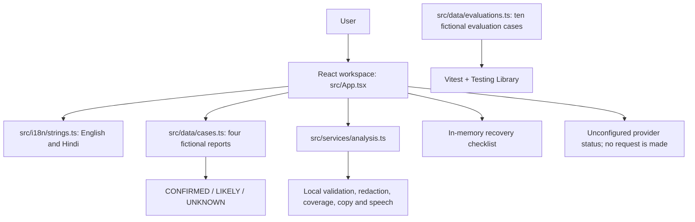

# FormRescue AI

**Stuck on a form? Go from error to done.** FormRescue AI is a bilingual recovery assistant concept for first-generation students, first-time internet users, applicants in India and people who prefer Hindi or simple English. It helps make a confusing form error easier to understand, separates evidence from uncertainty, and offers a practical next step.

This implementation is a working static demo. Four fictional reports are immediately available. Demo mode needs no account, API key, backend or network. Uploaded images are previewed locally but are **not analyzed**. There is no connected OCR/vision provider or official-source retrieval in this build.

## User journey and five-part evidence concept

A careful recovery flow can be thought of as five stages: **Intake** (choose the case or provide a screenshot/text/context), **Observation** (identify only what is actually visible), **Classification** (separate confirmed facts from plausible explanations and unknowns), **Verification** (find the real authority's current rule and resolve missing information), and **Recovery** (follow a safe checklist and verify the next outcome). The interface groups these into three understandable steps: **Understand → Verify → Recover**. Observation/classification are shown in the evidence panel; verification remains explicitly incomplete when no real authority source exists.

## Implemented features

- Responsive landing page, product-workflow illustration, navigation, stepper, sample cases, limitations, FAQ and print-friendly report.
- Four English/Hindi demo reports, each paired with an interactive fictional HTML/CSS portal screen. Every sample institution/rule is fictional and no source looks like a real official URL.
- Evidence labels **CONFIRMED**, **LIKELY** and **UNKNOWN**, each with a reason and additional information that would reduce uncertainty.
- Evidence coverage indicator computed from directly supported findings in the fictional report. It is an evidence-coverage tally, **not** an AI confidence score, statistical probability or guarantee of correctness.
- Checklist completion in page memory, missing-document possibilities, clarification questions, unverified facts, how to verify success, and what to do if retrying fails.
- English/Hindi switching, a simple-summary mode, browser Read aloud/Stop, WhatsApp-style copy, and browser Download/Print (Save as PDF).
- Local JPG/PNG/WebP selection (maximum 10 MB), preview, replace/remove, drag/drop and paste where supported. The image stays in browser memory; this app does not upload, OCR or analyze it.
- Optional solid rectangular redaction masks: draw, move, resize, remove individual masks, undo the last mask, clear all and preview a separate flattened PNG. A flattened mask is irreversible in that output, but it does **not** guarantee full anonymization; other identifying details can remain. The original file remains local and is never sent by this build.
- Optional category, jurisdiction and context fields. In demo mode these stay on the page and do not change the prewritten sample report.
- Reduced-motion styling, focus visibility, semantic form labels and an accessible static route manifest.

## Fictional sample cases

| Case | Fictional notice/rule | Evidence boundary |
|---|---|---|
| BrightPath Scholarship Portal | Upload exceeds a fictional 2 MB limit | The demo notice and fictional limit are confirmed only within the sample; actual accepted formats and real portal rules remain unknown. |
| Northstar Admissions Demo | Applicant name differs from certificate | The displayed strings differ; real matching rules and authorized correction route remain unknown. No falsifying or unauthorized changes are suggested. |
| CivicApply Demonstration Portal | Income certificate is older than a fictional six-month window; example date is eight months old | Notice, sample rule and sample dates are confirmed; real authority policy, route and renewal eligibility remain unknown. |
| ClearGrid Utilities Demo | Address proof not accepted under a fictional category list | The sample notice/rule are fictional; real alternative proofs and review processes remain unknown. |

Each source uses the exact label **“DEMO SOURCE — FICTIONAL RULE FOR THIS EXAMPLE”**, a stable internal `DEMO-*-RULE-*` ID, and no real URL, official publisher or retrieval timestamp. There are no real citations in this build.

## Safe-use limits

FormRescue does not submit applications, change official records, guarantee acceptance, reverse rejection decisions, replace a responsible authority/helpline, decide eligibility or identity, or infer facts missing from the evidence. It never asks for passwords or one-time codes. Check actual authority instructions whenever deadlines, rejection, eligibility or important document rules are uncertain. A fictional demo rule must never be applied to a real application without checking the real portal.

### Live AI and source retrieval

The Live AI switch is an honest status screen, not a working integration. This project intentionally has no provider credentials, endpoints, model ID, connection test, server adapter, OCR, structured live-result validator, or real source-retrieval connector. It requests no API key and sends no live request. To enable future live analysis, add a documented vision provider and capability, secure server-side credential handling for public hosting, consented/redacted image and context transfer, schema/evidence validation, explicit failure handling, and a real source-retrieval method. Until then, unknown rules stay unverified. Do not deploy a browser-visible provider secret.

## Privacy and redaction

- Demo cases are static source data. User-selected images, manually typed error text, optional context and checklist progress live in React page state only; there is no account, analytics event, local/session storage, backend upload or database.
- The warning asks users to remove passwords, one-time codes, payment-card details and unnecessary personal data before selecting a screenshot.
- Image type/size is checked in the browser. An unreadable image produces a preview error; there is no OCR fallback.
- Redaction creates a separate flattened preview. It is a convenience, not a promise of anonymity. Review the whole image before sharing it anywhere.
- Reloading/resetting clears this page's working state.

## Run locally

Requirements: Node.js and **pnpm 11.25.0** (the package manager is pinned in `package.json`).

```bash
pnpm install --frozen-lockfile
pnpm dev
```

The Vite dev server binds to `0.0.0.0:3000` for the managed Preview. Run checks and make a static build with:

```bash
pnpm test
pnpm build
```

`dist/` contains the deployable static single-page application. No environment variables are required for the implemented demo. `.env.example` describes the deliberately unconfigured provider boundary; do not add secrets to the repository.

## Architecture



Main source layout:

- `src/App.tsx`: single-page UX, local state, fictional portal components and report actions.
- `src/types.ts`: typed report, evidence, source and recovery contracts.
- `src/data/cases.ts`, `src/data/evaluations.ts`: sample and safety/evidence examples.
- `src/i18n/strings.ts`: interface copy for English and Hindi.
- `src/services/analysis.ts`: pure/client-only image and report utilities.
- `src/styles/global.css`: visual system, responsive breakpoints, reduced-motion and print rules.
- `public/manus-routes.json`: one-route SPA manifest; `public/formrescue-mark.svg`: site mark.

## Evaluation examples

`src/data/evaluations.ts` contains ten fictional cases and expected behavior:

1. Explicit fictional 2 MB limit: confirm only what is shown; do not generalize the rule.
2. Vague “upload problem”: state the cause cannot be determined and ask for exact text/rules.
3. Conflicting certificate status screens: surface the conflict; keep the cause unknown until reconciled.
4. Blurry “date/data missing”: do not claim either reading; request clearer evidence.
5. User-reported name mismatch without a screenshot: attribute it to the user and give safe comparison steps.
6. Fictional accepted-document list applied to a real provider: do not infer acceptance; direct user to the actual provider.
7. Application reference without rejection reason: do not infer rejection or eligibility.
8. Different displayed names without an identified field: separate visible difference from its uncertain cause.
9. User-reported document age without validity policy: keep the actual validity/rejection reason unknown.
10. Instruction-like text inside a screenshot: treat it as untrusted evidence, never as an instruction.

These are fictional evaluation examples, not evidence that a live AI model has been evaluated. Automated tests check the dataset's variety and expected behavior markers, selected report workflows, language mode, checklist, live-mode disclosure, image validation, copy/print and utility functions. Results below describe only commands actually run.

## Verification record

- `pnpm test`: **28 tests passed** across 2 files. Coverage includes the first-screen layout and collapsed optional details, all four English and Hindi report workflows, evidence/source labels, simple summaries, checklist/context reset, honest Live AI fallback, unsupported/oversized images, local preview/decode failure, direct image replacement with stale-mask clearing, English/Hindi manual-sample navigation, flattened PNG redactions, keyboard add/move/resize/delete for covers, print-only limitations markup, copy/print actions, evidence coverage, safe message export and the ten-example dataset.
- `pnpm build`: **passed** strict TypeScript compilation and Vite production build; `dist/` contains the static SPA.
- HTTP checks: `/` returned `200 text/html`; `/manus-routes.json` returned `200 application/json` with the single `/` page route; `/formrescue-mark.svg` returned `200 image/svg+xml`.
- Browser render smoke checks visually inspected the refreshed layout at 1280×800, 768×1024, 390×844 and 320×844. On the managed Preview, the hero sample opened a complete report, Hindi switched the active report, WhatsApp copy showed its success confirmation, and a checklist step changed its pressed state. Generated blank PNGs produced local-only previews; adding a mask, previewing the flattened copy, undoing it, invoking the replace button's file-input click, applying a second synthetic file change and confirming that the old mask cleared all worked. The browser harness simulated file selection and did not operate a native OS file dialog. The manual-text action navigated to sample cases, showed that no analysis was performed and did not create a report. These image interactions made no app fetch/XHR requests.
- The print action and report-only content (summary, evidence, recovery steps, fictional source and full safety limitations) have automated coverage; print CSS hides app chrome. Selected-report PDF output was not independently validated in a browser print preview.
- The typed Live AI adapter is intentionally not configured: there is no live vision provider, real screenshot analysis, external source retrieval, connection test or provider failure flow, so these are not claimed as working.
- The Preview browser exposed speech synthesis but had no installed voices, so it correctly showed the unavailable-voice state; actual playback and pointer-drag redaction were not verified. Keyboard creation, movement, resizing and deletion of covers are tested. A broad screen-reader audit and formal WCAG audit were not conducted.

## Hosting and next steps

This is a static-only SPA. Use the managed project's configured Vite build (`pnpm install --frozen-lockfile && pnpm build`) and publish the contents of `dist/` from a static host. No database, server or authentication is needed for the current product.

Next steps for a production recovery service: choose and document a supported vision provider; implement secure server-side credentials and explicit consent; validate a typed report result; add trustworthy official-source retrieval with URLs, excerpts and timestamps; harden image decoding and accessibility-test with target users; and perform real bilingual usability studies. No such integration or user outcome is claimed here.
